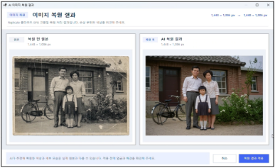
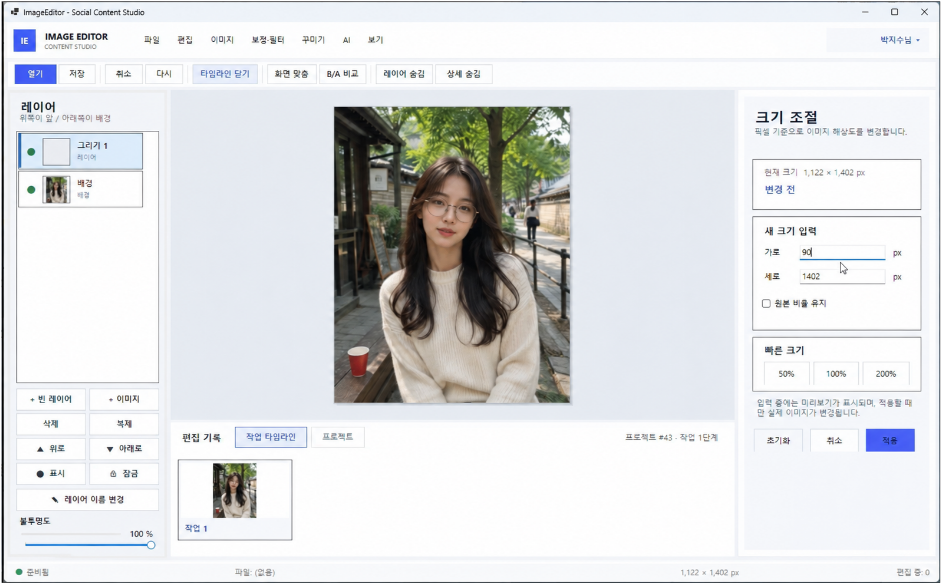
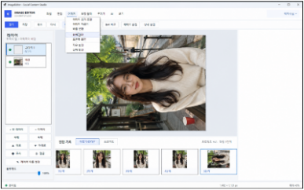
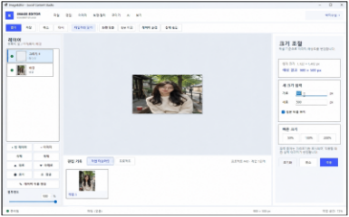
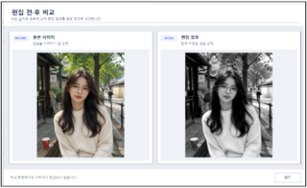
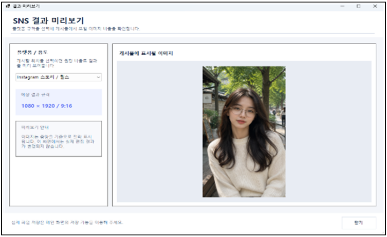
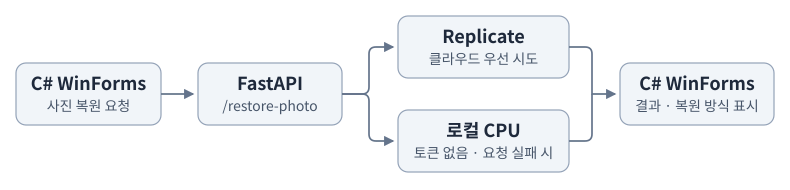

# Image Editor

C# WinForms로 만든 이미지 편집 프로그램입니다. 6명이 함께 만든 팀 프로젝트이고, 이 저장소에는 제가 맡은 크기 변경, 자르기, 회전·반전, 결과 미리보기, AI 오래된 사진 복원 코드만 올렸습니다.


<p align="center">
  
</p>

## 프로젝트 소개

- 기간: 2026.08.10 ~ 2026.08.21
- 인원: 6명
- 역할: 팀장

이미지를 불러와 크기 변경, 자르기, 회전, 밝기·대비 조절, 필터, 텍스트 넣기를 할 수 있고,
Python FastAPI 서버와 연동해 AI 배경·물체 제거, 오래된 사진 복원, 흑백 사진 컬러화를 지원합니다.

<p align="center">
  
</p>

## 맡은 부분

### 크기 변경, 자르기, 회전·반전

- 입력한 크기로 Bitmap을 새로 만들고, 비율 유지를 켜면 가로나 세로 하나만 바꿔도 나머지가 자동으로 계산됩니다. 50%, 200% 버튼과 고품질 보간(HighQualityBicubic)을 넣었습니다.
- 드래그한 영역을 실제 이미지 좌표로 바꿔서 자릅니다.
- 회전과 반전은 `RotateFlip`으로 처리합니다.

| 회전 | 크기 변경 |
|:---:|:---:|
|  |  |

### 결과 미리보기

- 처음 불러온 이미지와 지금 편집한 결과를 나란히 보여 주는 Before/After 화면을 만들었습니다.
- SNS 규격을 고르면 그 비율로 가운데를 잘라 미리 보여 줍니다.

| Before / After | SNS 미리보기 |
|:---:|:---:|
|  |  |

### AI 오래된 사진 복원

C#에서 이미지를 JPEG로 바꿔 FastAPI 서버에 비동기로 보냅니다. 서버는 먼저 Replicate 클라우드 복원을 쓰고, 토큰이 없거나 연결이 안 되면 로컬 CPU 복원으로 넘어갑니다.
로컬 복원은 노이즈 제거와 영역별 대비 보정(CLAHE)으로 손상을 줄이고, 컬러화 모델로 흑백이나 바랜 사진만 골라 컬러화하고, FSRCNN으로 디테일을 살립니다.
어떤 방식으로 복원했는지는 화면에 표시하고, 기다리는 중에는 취소 버튼으로 멈출 수 있습니다.



## 문제 해결

### 화면 좌표와 이미지 좌표 불일치
- **문제**: 화면에 보이는 크기와 실제 해상도가 달라서, 드래그 좌표를 그대로 쓰면 선택한 영역과 실제로 잘리는 영역이 다름
- **해결**: 이미지와 PictureBox의 가로·세로 비율로 좌표와 크기를 변환하고, 이미지 범위와 겹치는 부분만 자름

### AI 복원 처리 중 UI 응답 지연
- **문제**: 처음에는 이미지 변환과 서버 응답 대기를 UI 스레드에서 처리해, 복원 버튼을 누르면 복원이 끝날 때까지 창이 '응답 없음' 상태로 멈춤
- **해결**: JPEG 변환은 `Task.Run()`으로 분리하고 요청·응답은 `async/await`로 처리. 진행 중에는 상태 메시지를 보여 주고 실행 버튼을 막아 중복 요청 방지

### 외부 AI 서비스 장애 시 기능 중단
- **문제**: Replicate 토큰이 없거나 네트워크 오류가 나면 복원 기능 전체를 쓸 수 없음
- **해결**: 서버에서 Replicate 실패를 감지하면 로컬 CPU 복원으로 자동 전환하고, 어떤 방식을 썼는지 응답 헤더로 C#에 알려 화면에 표시

## 파일 구성

```
src/ImageEditor/
├── Controls/        # 크기 변경, 자르기, SNS 비율, 사진 복원 옵션
├── Tools/           # 자르기 좌표 변환, SNS 비율 계산
├── Forms/           # Before/After, SNS 미리보기, 복원 미리보기
├── Services/        # 복원 요청(PhotoRestorationService), SNS 내보내기
└── ImageProcessing/ # 회전, 반전, 크기 변경, 자르기
excerpt/
└── restore_photo_server.py   # 서버의 사진 복원 부분
```

`excerpt/restore_photo_server.py`는 팀원들의 AI 기능이 함께 들어 있는 서버 파일에서 제가 짠 사진 복원 부분만 옮겨 온 것이라 이것만으로는 실행되지 않습니다.

사용 기술: C#, WinForms, GDI+, async/await, Python, FastAPI, OpenCV, Replicate API

<!-- 시연 영상 링크 넣을 곳 -->
